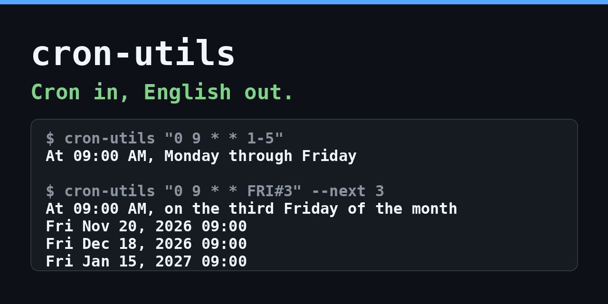

# cron-utils



**Your agent emits `0 9 * * 1-5`. Nobody on your team can read it.**

Agents, schedulers and infra-as-code emit cron expressions; humans get handed strings like `30 2 */3 * 1-5` and guess. The Go libraries that translate cron to English are six years stale: lnquy/cron panics on invalid input ([open issue](https://github.com/lnquy/cron/issues)), jsuar/go-cron-descriptor stopped in 2020, and gorhill/cronexpr is archived. Feeding LLM output into a parser that panics is not a parse error, it's an outage.

cron-utils validates, explains and previews cron schedules in one import. It never panics: bad input gets a typed error that says which field is wrong and why, so an agent can feed it straight back to the model.

```go
s, err := cronutils.Parse("0 9 * * FRI#3")
if err != nil {
    // *cronutils.ParseError: field, offending text, plain message
    return err
}
fmt.Println(s.Describe())
// At 09:00 AM, on the third Friday of the month

fmt.Println(s.NextN(time.Now(), 3))
// [Fri Nov 20, 2026 09:00  Fri Dec 18, 2026 09:00  Fri Jan 15, 2027 09:00]
```

There's also a small CLI for humans and demos:

```console
$ cron-utils "0 9 * * 1-5"
At 09:00 AM, Monday through Friday
```

## Install

Library:

```sh
go get github.com/ofershap/cron-utils
```

CLI:

```sh
go install github.com/ofershap/cron-utils/cmd/cron-utils@latest
```

Standard library only. No dependencies.

## What it does

- **Describes cron in English**, cronstrue-style: `0 9 * * 1-5` becomes "At 09:00 AM, Monday through Friday".
- **Validates with typed errors**: `ParseError` names the field, quotes the offending text and says what's wrong. Parse never panics, whatever the input.
- **Previews fire times**: `Next`, `Prev` and `NextN` compute occurrences in the caller's location, with day-skipping so `0 0 29 2 *` resolves in microseconds.
- **Speaks the dialects agents emit**: 5-field Vixie, 6-field with leading seconds, `@daily` and friends, month and weekday names, `?`, and the Quartz specials `L`, `LW`, `15W`, `FRIL`, `FRI#3`.
- **Vixie-correct**: when both day-of-month and day-of-week are restricted, a day matching either fires, the way cron itself behaves.

## What it doesn't do

- **Not a scheduler.** It computes fire times; it doesn't run your jobs. For running jobs see robfig/cron.
- **No `@reboot`.** It fires at daemon startup, not on a schedule; Parse rejects it with a clear error.
- **English descriptions only**, for now. The descriptor is one function, so locales are a possible later addition.
- **7-field Quartz years are rejected** with a clear error rather than silently mis-parsed.

## Errors an agent can use

```go
_, err := cronutils.Parse("0 25 * * *")
// cron: hours field "25": 25 is outside 0-23
```

The error tells the model exactly what to fix. Contrast with a panic, which tells it nothing.

<details><summary><b>How do I convert a cron expression to human-readable text in Go?</b></summary>
<code>cronutils.Describe("0 9 * * 1-5")</code> returns "At 09:00 AM, Monday through Friday". It handles 5-field and 6-field (seconds) expressions, @macros, month and weekday names, and the Quartz specials L, W and #.</details>

<details><summary><b>How do I compute the next run time of a cron expression in Go?</b></summary>
Parse the expression with <code>cronutils.Parse</code>, then call <code>Next(t)</code>, <code>Prev(t)</code> or <code>NextN(t, n)</code>. Times are computed in the input time's location, and sparse schedules like <code>0 0 29 2 *</code> (Feb 29) resolve in microseconds via day-skipping.</details>

<details><summary><b>Is cron-utils safe to run on LLM-generated cron expressions?</b></summary>
Yes. Parse and Describe never panic; malformed input returns a typed <code>*ParseError</code> naming the field and problem, designed to be fed back to a model. The test suite includes a table of hostile inputs asserting no panics.</details>

<details><summary><b>What's the difference between cron-utils and lnquy/cron or gorhill/cronexpr?</b></summary>
Those libraries stalled in 2020; lnquy/cron has an open panic-on-invalid-input issue and gorhill/cronexpr is archived. cron-utils combines description and occurrence computation in one dependency-free package, supports Quartz specials, and treats hostile input as a first-class case.</details>

## Contributing

Issues and PRs welcome - see [CONTRIBUTING.md](CONTRIBUTING.md). Please report security issues privately per [SECURITY.md](SECURITY.md).

---

More projects: [gitshow](https://github.com/ofershap/gitshow) · [real-browser-mcp](https://github.com/ofershap/real-browser-mcp) · [cursor-usage-tracker](https://github.com/ofershap/cursor-usage-tracker) · [mcp-server-markdown](https://github.com/ofershap/mcp-server-markdown) · [readme-builder](https://github.com/ofershap/readme-builder) · [grok-bot-skills](https://github.com/ofershap/grok-bot-skills) · [mashov-parent-brief](https://github.com/ofershap/mashov-parent-brief) · [gailwind](https://github.com/ofershap/gailwind) · [lather](https://github.com/ofershap/lather) · [json5](https://github.com/ofershap/json5) · [poppy-go](https://github.com/ofershap/poppy-go)

---

## Author

[](https://gitshow.dev/ofershap)

[](https://linkedin.com/in/ofershap)
[](https://github.com/ofershap)
[](https://ofershap.github.io/)

---

<sub>README built with [README Builder](https://ofershap.github.io/readme-builder/)</sub>

## License

[MIT](LICENSE) &copy; [Ofer Shapira](https://github.com/ofershap)
